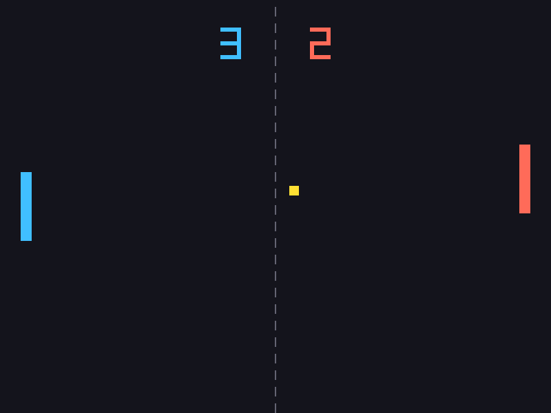
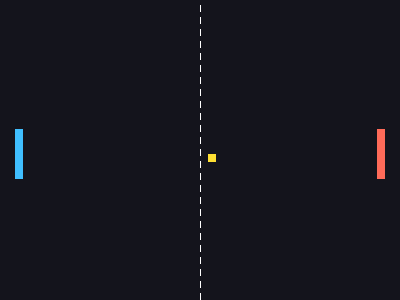

# Pong Game in Love2D

## Student Information
- **Full Name:** Leen Naeem Ahmad Hassoun (لين نعيم احمد حسون)
- **Class / Section:** Mon & Wed (8:00 AM - 10:00 AM) / شعبة الإثنين والأربعاء (8:00 - 10:00)

---

## 📖 Game Description
This project is a recreation of the classic arcade game **Pong**, built from scratch using the **Love2D (LÖVE)** 2D game framework in Lua. Two players control paddles on opposite sides of the screen to rally a ball back and forth. The game implements 2D coordinate positioning, smooth frame-rate independent movement powered by delta time (`dt`), Axis-Aligned Bounding Box (AABB) rectangle collision detection, boundary collision physics, scoring, and custom gameplay enhancements.

---

## 🎮 How to Run the Game

### Prerequisites
Make sure you have **Love2D** installed on your operating system:
- **macOS:** Install via Homebrew: `brew install --cask love` or download directly from [love2d.org](https://love2d.org/).
- **Windows / Linux:** Download the installer or package from [love2d.org](https://love2d.org/).

### Running from Terminal
1. Open your terminal or command prompt.
2. Navigate to the project root directory:
   ```bash
   cd path/to/pong-love2d
   ```
3. Run the game using:
   ```bash
   love .
   ```
*(On macOS, if `love` is not in your PATH, you can run: `/Applications/love.app/Contents/MacOS/love .` or drag the `pong-love2d` folder onto the Love2D application icon).*

---

## 🕹️ Controls

| Action | Player 1 (Left Paddle) | Player 2 (Right Paddle) |
| :--- | :---: | :---: |
| **Move Up** | <kbd>W</kbd> | <kbd>▲ Up Arrow</kbd> |
| **Move Down** | <kbd>S</kbd> | <kbd>▼ Down Arrow</kbd> |
| **Serve / Start Round** | <kbd>Space</kbd> | <kbd>Space</kbd> |
| **Quit Game** | <kbd>Esc</kbd> | <kbd>Esc</kbd> |

---

## ✨ Description of Your Own Change (Custom Features)
To make the game more engaging and visually distinct beyond the basic video requirements, the following custom features were implemented:

1. **Distinct Paddle & Ball Colors:**
   - **Player 1 (Left):** Vibrant Neon Cyan (`rgb(64, 191, 255)`)
   - **Player 2 (Right):** Coral Red (`rgb(255, 107, 89)`)
   - **Ball:** Golden Yellow (`rgb(255, 224, 51)`)
   - **Center Net & Scoreboard:** Integrated matching aesthetic with colored scores.

2. **Dynamic Ball Acceleration:**
   - Every time a player successfully deflects the ball with their paddle, the ball's horizontal velocity increases by **5%** (`ball.dx = ball.dx * 1.05`). This gradually escalates the speed and intensity of rallies.

3. **Space to Serve & State Management:**
   - Implemented a `"serve"` and `"play"` state machine. After a point is scored, the ball resets to center and waits for either player to press <kbd>Space</kbd> to serve, displaying clear on-screen instructions.

---

## 🧠 Core Love2D Concepts & Callbacks

### 1. The Three Core Callbacks
- **`love.load()`**: Executed once when the game starts. Used for initialization: setting window properties, loading fonts, initializing scoreboards, and defining paddle and ball tables.
- **`love.update(dt)`**: Executed every frame to update game logic, handle movement inputs, perform collision detection, and track scores. It receives `dt` (Delta Time) as an argument.
- **`love.draw()`**: Executed every frame after `update`. It handles all visual rendering on the screen (drawing rectangles, scores, center court lines, and UI messages).

### 2. Delta Time (`dt`)
- **What is `dt`?** Delta time is the time in fractional seconds elapsed since the last frame (e.g. `1/60 ≈ 0.0167s` at 60 FPS).
- **Why is it critical?** Without `dt`, an object moving `speed = 5` pixels per frame would move twice as fast on a 120Hz display (600 pixels/sec) compared to a 60Hz display (300 pixels/sec). By multiplying speed by `dt` (`position = position + speed * dt`), speed is defined in **pixels per second**, guaranteeing perfectly identical movement speed across both fast and slow computers.

### 3. AABB Collision Detection
Rectangle-to-rectangle collision is verified using the Axis-Aligned Bounding Box formula:
```lua
function checkCollision(a, b)
    return a.x < b.x + b.width and
           a.x + a.width > b.x and
           a.y < b.y + b.height and
           a.y + a.height > b.y
end
```
When a collision is detected, the ball's horizontal direction is flipped, and its position is pushed outside the paddle surface to prevent the ball from clipping or getting trapped inside.

---

## 📸 Screenshots



---

## 🎥 Demo Video / Animation



*(Note: You can also place an MP4 recording of your gameplay inside the `demo/` folder, e.g. `demo/gameplay.mp4`).*

